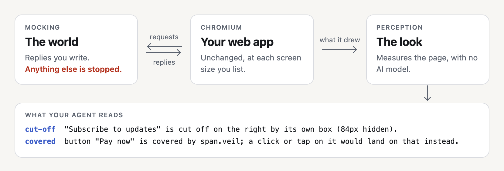
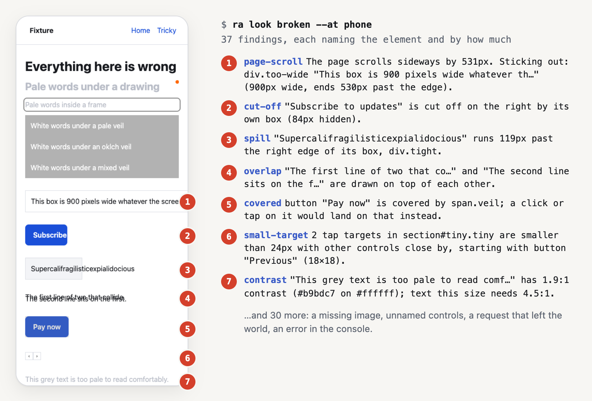

# ra

**Catch the UI bugs your agent can't see.**

[](https://github.com/hraness/ra/releases/latest)
[](https://github.com/hraness/ra/actions/workflows/ci.yml)
[](LICENSE)

ra opens your web app in Chromium, inside a fake world you describe, and tells your coding agent in sentences what a person would find wrong: text cut off, a button that something else covers, grey text too pale to read, or a page that scrolls sideways on a phone. It is UI testing for agents, made to run in the middle of a change.

<picture>
  <source media="(prefers-color-scheme: dark)" srcset=".github/media/ra-flow-dark.png">
  
</picture>

## Start

ra needs Node 22.18 or later, on macOS or Linux. Install it from its GitHub release, then look at a page of your running app:

```sh
npm install -D https://github.com/hraness/ra/releases/download/v0.3.0/hraness-ra-0.3.0.tgz playwright-core
npx playwright-core install chromium
npx ra look http://127.0.0.1:3000/ --at phone
```

If your project already has `playwright` or `@playwright/test`, leave `playwright-core` out and install the browser with `npx playwright install chromium`.

That first look needs no config. It prints the findings, an outline of the page, a sketch of its layout, and where it saved two pictures. To check every screen of your app in one run, [name its states](#setting-up) and run `ra check`. To have your coding agent run ra by itself, give it [the skill](#for-coding-agents).

## What it finds

Each finding is one sentence that names the element and, where it can, says by how much.

<picture>
  <source media="(prefers-color-scheme: dark)" srcset=".github/media/ra-look-dark.png">
  
</picture>

That is `ra look broken --at phone` on [a fixture page](test/fixtures/site/broken.html) of planted problems. It printed 37 findings, and the picture shows seven. There are 19 kinds:

- **Layout:**
  - [`page-scroll`](docs/findings.md#page-scroll): the page scrolls sideways.
  - [`cut-off`](docs/findings.md#cut-off): text or a control is clipped by a box that hides overflow.
  - [`spill`](docs/findings.md#spill): text runs out of its box.
  - [`overlap`](docs/findings.md#overlap): two pieces of text are painted over each other.
  - [`covered`](docs/findings.md#covered): something sits on top of a control, so a click would land on that instead.
- **Reading and reaching:**
  - [`contrast`](docs/findings.md#contrast): text has too little contrast with what is painted behind it.
  - [`small-target`](docs/findings.md#small-target): tap targets on touch views are small and crowded.
  - [`no-name`](docs/findings.md#no-name): a control has no accessible name, or an image has no alt text.
- **Content:**
  - [`image`](docs/findings.md#image): an image did not load, or is stretched.
  - [`blank`](docs/findings.md#blank): the page shows nothing.
  - [`document`](docs/findings.md#document): there is no title or viewport, or the status is unexpected.
  - [`error-overlay`](docs/findings.md#error-overlay): a dev-server error overlay is showing.
- **Behaviour:**
  - [`console`](docs/findings.md#console): an error was logged.
  - [`request`](docs/findings.md#request): a request failed or answered 4xx/5xx.
  - [`outside`](docs/findings.md#outside): a request left the world.
  - [`load`](docs/findings.md#load): the page did not load.
  - [`busy`](docs/findings.md#busy): the page never went quiet.
  - [`expect` and `steps`](docs/findings.md#expect-and-steps): your own checks or steps failed.

A false alarm sends an agent to change a page that was right, so ra counts one as a bug. Its twin fixture, [`tricky.html`](test/fixtures/site/tricky.html), holds 14 sections of things that only look wrong, such as deliberate ellipses, line clamps, scrolling strips, off-screen drawers, and screen-reader-only text. ra's tests fail if it reports anything there, at desktop or phone size, in dark mode, with scripts off, or after a jump down the page. [docs/findings.md](docs/findings.md) says how each kind is decided, what it deliberately leaves alone, and how to accept one.

## How it works

ra has two halves, and your app runs unchanged between them. Nothing runs inside your app: there is no SDK, bridge, test build, or fixtures database.

### The world: the mocking half

The world is everything outside your app, and you describe it in `ra.config.ts`. It decides what each request gets, in this order:

1. **A reply you wrote** (`replies`) answers in the server's place.
2. **A host you block** (`block`), such as analytics, is dropped quietly.
3. **The app itself** answers its own paths.
4. **A host you allow** (`allow`), such as a font CDN, is really reached.
5. **Anything else** is stopped and reported as an `outside` finding.

The broken fixture page makes seven requests. The app answers five, and the two to `api.example.com` and `analytics.example.com`, which nothing in its world answers, are stopped and reported.

Beneath those rules the browser itself is closed, so what routing never sees, such as a redirect hop, an IP address, or a WebRTC connection, is stopped too ([the browser](#the-browser) says how). `ra doctor` tries four ways out, and each must be stopped. The world stays closed when ra looks at a deployment, too.

A **state** is a URL into a world: a path, plus the replies, storage, cookies, and clock that go with it, and optional steps. You name each state once, such as an empty inbox, a failed payment, or a name 80 characters long, and ra looks at it through every **view** you list, such as desktop, a phone, and dark mode. Stand-in servers (`upstreams`) answer what your app's *server* calls.

### The look: the perception half

The look reads the page five ways, and no model takes part in any of them:

| Reading | How ra takes it | What it finds |
| --- | --- | --- |
| Boxes | The layout engine's own rectangles for each element and each line of text, set against the screen, the boxes that clip them, each other, and each image's own size. | `page-scroll`, `cut-off`, `spill`, `overlap`, `small-target`, `image`, `blank` |
| What is on top | The element the browser reports on top at the centre of each control, tested as ra scrolls down the page in half-screen steps, up to 40 screens. | `covered` |
| Two pictures | The page as it is, and the page with every glyph made transparent, which shows the true background under each line of text, whatever painted it: a gradient, a photo, an overlay, or a blend. | `contrast` |
| Roles, names, and the document | Each control's role and accessible name, which ra also prints as the outline, and the page's title, viewport, and response status. | `no-name`, `document`, `error-overlay` |
| The console and the network | Every error logged and every request made, until the network has been quiet for 200 ms or 5 seconds have passed. | `console`, `request`, `outside`, `load`, `busy` |

Your own checks add the last two kinds, `expect` and `steps`.

What comes out is text first, with two pictures for when the words leave a doubt. `ra check` takes the same look at every state through every view, and exits 1 when anything is wrong.

## How it compares

An agent that wants to know whether its UI change worked has three easy options, and each misses something.

| | Screenshot to a model | Script against the network | Accessibility snapshot | ra |
| --- | --- | --- | --- | --- |
| Who decides what is wrong | The model, by eye | Your assertions | The model, from text | Measurements |
| Contrast, overlap, clipping, covering | Often misjudged | Only what you assert | Not in the tree | Measured and reported |
| Live services in the loop | Unless you mock them | Unless you mock them | Unless you mock them | Only the hosts you allow by name; any other request is stopped and reported |
| Empty, failing, and overflowing states | Reached by hand | Mocks you write | Reached by hand | Named once in a config |

**A screenshot for a model to judge.** Models are weakest at the measurements that layout bugs come down to. In [UI-Lens](https://openaccess.thecvf.com/content/CVPR2026/papers/Xiang_UI-Lens_Assessing_General_MLLMs_Potential_to_Automate_UI_Display_Quality_CVPR_2026_paper.pdf) (CVPR 2026), nine multimodal models judged screens from 11 mobile apps. On text overflow their accuracy averaged 50.04%, where a coin flip scores 50%, and on container overlap 54.14%. A screenshot also shows only what fits in it. The broken fixture page is 921px wide in a 390px view, so a picture of the screen crops more than half of it, and a picture of a long page is scaled down before the model sees it: [Claude's docs](https://platform.claude.com/docs/en/build-with-claude/vision) cap the long edge at 2,576px, or 1,568px before Claude 4.7, so a page 5,000px tall arrives at half its size or less. ra measures instead: boxes from the layout engine, and contrast from the painted pixels.

**A Playwright script against the real network.** Browser tests flake far more than most tests. At Google, WebDriver tests were flaky six to eleven times as often as tests overall: 10.45% in Java and 18.72% in Python, against 1.65% ([Google Testing Blog, 2017](https://testing.googleblog.com/2017/04/where-do-our-flaky-tests-come-from.html)). A 2025 study found that three quarters of flaky tests fail together in clusters, with “intermittent networking issues and instabilities in external dependencies as the predominant causes” ([Parry et al.](https://arxiv.org/abs/2504.16777)). Playwright's own advice is “Only test what you control” ([best practices](https://playwright.dev/docs/best-practices)). ra does that for every state, with no test code: its world is fake by default, and a request that nothing in it answers is stopped and reported.

**An accessibility snapshot.** A tree of roles and names is text a model can read, but it leaves out colour, geometry, and stacking order, so it cannot show low contrast, overlap, clipping, or a covered button. On the broken fixture page, those are 29 of the 37 findings. ra prints the same kind of outline and puts measured findings beside it.

### Other tools

This list dates from November 2026, and each of these tools moves fast.

- **Agent browsers**, such as Playwright MCP, Chrome DevTools MCP, and agent-browser, give the agent a page to drive, its accessibility tree, and pictures. Whether the layout is right is left to the model. ra measures the layout and hands the agent a verdict.
- **Visual regression tools**, such as Chromatic, Percy, Argos, Meticulous, and BackstopJS, compare new pictures with earlier ones. They show every change, wanted or not, and someone decides which changes are bugs. A bug that was there from the start is part of the baseline. `ra check` needs no baseline, and `ra snap` and `ra diff` say in words what moved during one change.
- **Accessibility engines**, such as axe-core and Lighthouse, check many more rules than ra has. Run one alongside ra, which adds what only the painted page shows: contrast over images and gradients, text that is clipped or spills, and controls that something else covers.
- **Rendered-UI linters** are the closest. [renderlint](https://github.com/ngocanhnckh/renderlint) shares ra's premise and measures contrast the same way, with more rules, a sweep across widths, stress passes with longer text, and a Stop hook for Claude Code. [Impeccable](https://github.com/pbakaus/impeccable)'s `detect` looks for design “slop” with deterministic rules. ra puts its weight on the world around the page: each state brings its own replies, storage, cookies, and clock, a request that nothing answers is reported, and the same closed world holds when ra looks at a deployment.

## When to use it

A browser check costs more than a unit test: each look loads the page in a real browser and waits for it to settle, and browser tests flake more than most ([how it compares](#how-it-compares)). So ra is worth running when the answer depends on what a browser paints.

**Use ra when:**

- **The question is “what does a person see here?”** For example, whether this fits at 320px, whether dark mode keeps the text readable, whether anything covers the button, and whether the long name spills out of its card. Only the layout engine knows, because the answer depends on the fonts, the cascade, and the width of the screen.
- **The state is expensive to reach by hand.** Examples are an empty inbox, a failed payment, a 3,000-row table, an upstream returning 500, a name 80 characters long, or a clock just before midnight. You name each one once as a URL plus a fake world, and from then on one command reaches it.
- **A change has a visual blast radius.** Examples are a CSS refactor, a design-token change, or a dependency bump. Run `ra snap`, make the change, then run `ra diff`. It tells you which elements moved, resized, appeared, or vanished, which outline lines changed, and which findings are new.
- **An agent is changing UI.** It works from text it can act on, and opens a picture only when the text is not enough.

**Do not use ra for:**

- **Logic.** If it can be tested without a browser, test it without one.
- **Restating the implementation.** Asserting `toHaveCSS("color", "rgb(…)")` or a class name proves that you wrote what you wrote. ra asks what a person would ask instead: whether the text can be read, whether the control can be reached, and whether it fits.
- **Proving a live system works.** ra closes the world on purpose. Smoke tests and monitoring against real services do that job. `ra check --url https://…` against a deployment checks what the deployment *shows*, and the outside world stays closed even then.
- **Pixel baselines in CI, or coverage ledgers.** Rendering varies from host to host, so a baseline holds only where it was made ([design decisions](#design-decisions)). Snapshots in ra live on your machine for the length of one change. CI runs `ra check`, which has no baselines.
- **Cross-browser matrices.** ra drives Chromium only. Use Playwright Test when WebKit- or Firefox-specific behaviour matters.
- **A full accessibility audit.** ra reports what a person would trip over: unnamed controls, missing alt text, low painted contrast, and small tap targets. Run axe or a manual audit for the rest.

### Limits

- ra drives Chromium only, on macOS and Linux.
- It is not a full accessibility audit.
- Placeholder text is not checked for contrast yet.
- Contrast is read from painted pixels, so text close to a threshold can pass under one system's font rendering and fall short under another's.
- Pictures and contrast cover at most the first 12,000px of a page. ra says so when a page is taller.
- When a page scrolls inside an element rather than as a whole, its pictures show that element's first screen, and ra says so.

## For coding agents

ra comes with a skill, [`skills/ra/SKILL.md`](skills/ra/SKILL.md), that teaches a coding agent when to reach for ra and how to read what it prints. It ships in the package. Copy it to where your agent reads skills; for Claude Code, that is:

```sh
mkdir -p .claude/skills
cp -R node_modules/@hraness/ra/skills/ra .claude/skills/
```

The loop:

1. Run `ra look <state> --at phone`, read the findings and the outline, and fix what is wrong.
2. Run `ra look` again to confirm. Run `ra check` before handing off.
3. For a change with a wide reach, run `ra snap` first and `ra diff` afterwards.
4. Open a picture only when the words leave a doubt, such as how a gradient looks. Every look writes `.ra/look/<state>.<view>.png` (the first screen) and `.full.png` (the whole page).

A look is short, and it is text the agent can act on. On ra's fixture site, a page with nothing wrong prints 52 lines, about 500 tokens at four characters a token: “no findings”, an outline whose lines map onto `getByRole`, a sketch of the layout, and where the pictures are. The broken page at phone prints 123 lines, about 1,900 tokens, for 37 findings. A picture of that whole page, 921×2523, would cost up to 3,003 tokens under [Claude's formula](https://platform.claude.com/docs/en/build-with-claude/vision) of one token for each 28×28-pixel patch.

When one faint colour is used in many places, a look names the first ten texts and counts the rest. On one public page, 235 of 237 findings were the same grey at 3.5:1: listing every one took 532 lines, and naming ten takes 83 ([#11](https://github.com/hraness/ra/pull/11)).

<details>
<summary>A look at a page with nothing wrong, trimmed</summary>

```
$ npx ra look home --at desktop
home at desktop (1440×900)
http://127.0.0.1:57437/ — 200 — "Fixture — Home"
page 1440×1237, 3 requests, 1.1s

no findings

outline
  banner
    link "Fixture" → /
    navigation "Main"
      link "Tricky" → /tricky
      link "Broken" → /broken
      link "App" → /app
  main
    heading "A page with nothing wrong" [level=1]
    paragraph: This page is the control. Whatever ra reports here is a false alarm, at any width and in either colour scheme.
    link "Open the app" → /app
    …
    heading "A form" [level=2]
    textbox "Email"
    checkbox "Send me news"
    button "Sign up"
  contentinfo
    …

layout
  header.top                        1440×65 at 0,0  sticky, 3 items in nav, 3 across
    nav "Main"                      192×40 at 1228,12  3 items, 3 across
  main "A page with nothing wrong"  960×1027 at 240,65  3 items in ul.cards, 3 across
    form                            920×176 at 260,836  3 items stacked
  footer                            1440×145 at 0,1092  3 items in nav, 3 across
    nav "Footer"                    1400×40 at 20,1117  3 items, 3 across

pictures: .ra/look/home.desktop.png (first screen), .ra/look/home.desktop.full.png (whole page)
```

</details>

## Setting up

ra needs Node 22.18 or later and a Playwright in your project: `playwright-core`, `playwright`, or `@playwright/test`. With Bun, install it like this:

```sh
bun add -d https://github.com/hraness/ra/releases/download/v0.3.0/hraness-ra-0.3.0.tgz playwright-core
bunx --no-install playwright-core install chromium
```

To upgrade, give the new release's address the same way. npm replaces the old one: `npm install -D <new address>`. Bun stops with `DependencyLoop` while its lockfile names the old address, so remove ra and add it again (`bun remove @hraness/ra`, then `bun add -d <new address>`), or change the address in `package.json` and run `bun install`.

`ra look` also takes the address of a deployment:

```sh
npx ra look https://example.com/pricing --at phone.dark
```

To name states, add `ra.config.ts` at the project root:

```ts
import { defineConfig } from "@hraness/ra";

export default defineConfig({
  app: { command: "bun run dev --port {port}" },
  views: ["desktop", "phone", "phone.dark"],
  world: {
    allow: ["fonts.googleapis.com", "fonts.gstatic.com"],
    block: ["*.posthog.com"],
    replies: { "GET /api/me": { json: { name: "Ada" } } },
  },
  states: {
    home: "/",
    pricing: "/pricing",
    "inbox-empty": { url: "/inbox", world: { replies: { "GET /api/messages": { json: [] } } } },
    "inbox-down": {
      url: "/inbox",
      world: { replies: { "GET /api/messages": { status: 500, json: { error: "down" } } } },
      see: ["Something went wrong"],
    },
    "long-name": {
      url: "/settings",
      world: { replies: { "GET /api/me": { json: { name: "Wolfeschlegelsteinhausenbergerdorff" } } } },
    },
  },
});
```

Then:

```sh
npx ra states                     # what this project names
npx ra look inbox-empty --at phone
npx ra check                      # every state through every view; exits 1 on findings
npx ra snap && $EDITOR app.css && npx ra diff
```

Node strips the types from `ra.config.ts`, so relative imports in it need their `.ts` extension, and it cannot use path aliases. [Recipes](docs/recipes.md) covers choosing states and views for each kind of app.

## In CI

Run `ra check`. It needs no stored baselines, so it only fails when something is wrong now:

```yaml
- run: bun install --frozen-lockfile
- run: bunx --no-install playwright-core install --with-deps chromium
- run: bunx --no-install ra check
```

A failing check prints each finding once, tagged with the views it shows at when that is not every view, and ends with a receipt for the browser it ran. This is ra's own fixture site, trimmed:

```
$ ra check
ra check — 23 states, 33 looks in 10.4s — http://127.0.0.1:58744

✗ noscript  /noscript
  contrast  "This line shows only when scripts are o…" has 1.9:1 contrast (#b9bdc7 on #ffffff); text this size needs 4.5:1.
            at p.faint "This line shows only when scripts are o…"
✗ broken  /broken
  cut-off       "Subscribe to updates" is cut off on the right by its own box (84px hidden).
                at button.button.cut "Subscribe to updates"
  covered       button "Pay now" is covered by span.veil; a click or tap on it would land on that instead.
                at button.button "Pay now"
  outside       The page asked api.example.com for data (GET https://api.example.com/v1/me); nothing in its world answers. Give api.example.com a reply, or list it under allow or block.
  page-scroll   The page scrolls sideways by 531px. Sticking out: div.too-wide "This box is 900 pixels wide whatever th…" (900px wide, ends 530px past the edge). [phone, phone.dark]
  …
✗ pinned  /pinned
  covered  button "Add to cart" is covered by p "Free shipping over fifty"; a click or tap on it would land on that instead.
  covered  p.cookies "This site keeps a cookie." covers 2 controls: button "Help", button "Chat".
           at button.help "Help"
…
✗ leave  /leave
  load     The page did not load, because a redirect from /leave sent it outside its world, to https://example.com/ (net::ERR_PROXY_CONNECTION_FAILED at http://127.0.0.1:58744/leave). The outside finding says more.
  outside  A redirect from /leave tried to take the page to https://example.com/, which is not in its world, and was stopped. The browser follows redirects by itself, so a reply for example.com cannot answer it. Give /leave a reply that does not redirect there, or list example.com under block to stop it quietly, or under allow to let it through.
…

✓ home
✓ tricky
…

57 findings in 13 of 23 states, with 3 notes. Look closer: ra look noscript --at desktop
browser: Chromium 158.0.8127.18, playwright-core 1.65.0, ~/Library/Caches/ms-playwright/chromium-1254/…/Google Chrome for Testing
```

`ra check --json` prints every look as data, for tools that want more than the exit code.

## Reference

### Commands

| Command | What it does |
| --- | --- |
| `ra look <state \| /path \| address>` | Looks at one state through its first view, or the views given with `--at`. Prints the outline, the layout, the findings, and where the pictures are. `--in "<selector>"` narrows it to part of the page. `--then "<code>"` runs Playwright code first, with `page` in scope, and prints what it returns; `@file.js` reads that code from a file. `--full` prints the whole outline. |
| `ra check [state…]` | Looks at every state through every view. Each finding is listed once, with the views it shows at. Exits 1 when anything is wrong. |
| `ra snap [state…]` | Keeps how the states look now. |
| `ra diff [state…]` | Says what changed since the snapshot, in words, and writes a copy of each changed picture with the changes framed. |
| `ra states` | Lists the states this project names. |
| `ra doctor` | Shows which browser ra runs, starts it, and tries the closed world in it. |

These options work with every command: `--url <origin>` uses an app that is already running, or a deployment. `--allow <host>` lets the page reach that host during this run. `--json` prints data instead of text. `--config <file>` and `--jobs <n>` do what they say.

Exit codes: `0` fine; `1` `ra check` found something; `2` the command or the config is wrong; `3` the app or the browser could not run. On Ctrl-C, ra closes the browser and stops the app, then exits with `130` (`143` for SIGTERM).

### Config

**`app`** says how to reach the app. It takes one of three forms:

- `{ command, ready?, env?, timeout? }` runs a shell command. `{port}` in the command is replaced with a free port, which is also set as `PORT`.
- `{ static: "dist" }` serves built files. It understands clean URLs and serves a 404 page if there is one.
- `{ url }` points at an app that is already running.

With `command`, the app runs in its own process group under a small keeper process. The keeper ends the whole group, background jobs included, when ra finishes, when ra is interrupted, and even when ra is killed outright.

**`views`** lists what to look through:

- The built-in views are `desktop` (1440×900), `tablet` (820×1180, touch), `phone` (390×844, touch), and `narrow` (320×640, touch).
- A size such as `1024x768` also works.
- Any of these can be followed by `.dark`, `.light`, `.touch`, or `.motion` (which leaves animations running).
- Custom views are `{ name, width, height, touch?, scale? }`.
- The default is `["desktop", "phone"]`.

**`world`** says what everything outside the app answers. Set it for the whole project and lay more over it for each state:

- **`replies`**: rules mapped to answers. A rule can be:
  - a path on the app: `"/api/items"`
  - a method and a path: `"POST /api/items"`
  - a full address: `"https://api.example.com/v1/**"`
  - a host: `"*.example.com"`

  `*` matches within one path segment and `**` matches across segments. The most literal matching rule wins. An answer is `{ status?, json?, body?, type?, headers? }`, where `body` is text or bytes, or a function of the request that returns one. ra checks every rule and every fixed answer when it reads the config, and says how to write one it cannot use. An answer that a function returns is checked when it is returned.
- **`block`**: hosts or addresses to drop quietly, such as analytics.
- **`allow`**: outside hosts the page may really reach, such as a font CDN.
- **`upstreams`**: stand-in servers for what the app's *server* calls. Each name gets a loopback address, passed to `app.command` and `app.env` as `{upstream.NAME}`. Point your server's API base URL at it.

ra decides what happens to each request in this order: a reply, then a block, then the app itself, then an allow. Anything else is stopped and reported as an `outside` finding.

The browser follows a redirect by itself, so routing sees only the first request. A reply cannot answer where a redirect leads: give the reply to the address that redirects. ra stops every hop that leaves the app and its allowed hosts, and reports it. It stops a hop by its host, so a hop goes through to an allowed host even when the allow rule names only some paths there, and to any path on the app, even one under `block`. The states of one run share a browser, so a host that one state allows is open to the others' redirects too. ra reports each such hop as having gone through, and says why.

**`states`** are named entries. Each is a path, or an object with these fields:

- `url`, plus a one-line `note`.
- `world`, laid over the project's world.
- `storage`, `session`, and `cookies`: the starting localStorage, sessionStorage, and cookies.
- `clock`: the time the page believes it is.
- `ready`: a selector that must be visible before the state counts as reached.
- `steps(page, reached)`: actions that reach the state after the page loads.
- `see`: text that must be visible.
- `expect(page, reached)`: anything else that must hold; throw to fail.
- `status`: the response status this state is meant to have, when it is not a success.
- `views`: views for this state instead of the project's.
- `accept`: findings to accept for this state.
- `scroll`: whether ra scrolls through the page, testing each control as it passes the middle of the screen. A state without steps is scrolled unless this is `false`. A state with steps is looked at where its steps leave it unless this is `true`.
- `live: true`: marks the state as safe to look at on a deployment.
- `javascript: false`: looks at the page with its scripts turned off, as a reader without JavaScript or a crawler sees it, `<noscript>` content included. Every check still runs. It is still a read-only page load, so it does not make a state local, and a run against a deployment may use it without `live`. With scripts off, `session` is not set, since no script could read it, and `see` cannot match text inside `<noscript>`; check that text in `expect` with a CSS locator. The browser refuses the page's scripts and script preloads then, and ra does not report that.

A state with its own world or steps only makes sense on your machine. Against a deployment, `ra check --url https://…` skips such states unless they are marked `live`, and `ra look` refuses them.

Against a deployment, the deployment answers for itself: no reply rule stands in for it, though `block` still applies to its paths. Outside hosts stay closed unless they are allowed, so a check against a deployment shows exactly what the page depends on. It answers whether the deployment looks right, not whether the services behind it work. Give ra the address the deployment settles on, since only that origin counts as the app: when it redirects to https or to `www.`, the page does not load, and the finding names the address to look at instead.

**`accept`** lists findings you have decided to live with: `{ finding: "contrast", match: "hero", why: "The hero text sits on a photo we test by hand." }`. A `why` is required, and it is printed wherever the finding appears. When every state is checked, `ra check` names the accept entries that matched nothing, so stale ones get removed.

Other settings: `tapTarget` (default 24), `timeout` (default 30000), `settle` (default 5000), `locale` (default `en-US`), and `timezone` (default `UTC`). `timeout` is how long ra waits for a page to load and for its `ready` mark, and how long a state's `steps`, its `expect`, and ra's own checks may take. A part that runs longer is reported, and the run goes on with the next look. A state's `steps` and the `--then` code are timed as a whole, so a long flow may need a larger `timeout`. It takes milliseconds above 0 and up to 2147483647.

### The browser

ra runs the Chromium that your project's own `playwright-core` installed, in headless mode. Before launching, it:

- resolves the executable and follows symlinks
- refuses any path into an installed Google Chrome
- requires the file to sit in Playwright's versioned browser directory
- learns Playwright's default switches for that version without starting a browser, by pointing Playwright at a script that writes down its arguments

It then launches with:

- a single `--disable-features` switch holding Playwright's list plus `PaintHolding` and `MacAppCodeSignClone`
- `--mute-audio`
- the closed world: a proxy that refuses everything, bypassed only for the app on its own port and for the allowed hosts; a host-resolver rule that lets no other name resolve; and WebRTC held to proxied connections, which that proxy refuses

After launch, ra reads `Browser.getBrowserCommandLine` and refuses to continue unless the running browser has every one of these. Every run ends with a receipt line. `ra doctor` shows the same receipt and tries the closed world: a throwaway app must answer, while another port on this machine, an IP address, an outside host, and a WebRTC connection must each be stopped.

ra runs on macOS and Linux with playwright-core 1.58 or later. Its browser tests run on 1.58.2, 1.62.1, and 1.65.0.

### As a library

`defineConfig` is all most projects need. Scripts that drive a browser themselves can also use:

- `openBrowser`: the launch policy and its receipt
- `closeWorld`: the closed world's routing, applied to any `BrowserContext`. Launch the browser with the switches beneath it, so that what routing never sees is stopped too. `reachableHosts` returns `null` when a world lets every host through, and then there is nothing to close:

  ```ts
  const hosts = reachableHosts(worlds);
  const owned = await openBrowser({ args: hosts === null ? [] : closedWorldSwitches(origin, hosts) });
  ```

  Like Playwright, `openBrowser` closes the browser on SIGINT, SIGTERM, and SIGHUP, and exits on Ctrl-C. Pass `handleSignals: false` when your script handles those signals itself.
- `ruleProblem`: what is wrong with a rule, in words, or `null`
- `observe` and `inspectPage`: a look. When one browser serves several worlds, pass `observe` the same hosts as `reachable`, so that it knows which redirects the browser let through.
- `compareLooks`: a diff

## Design decisions

[How it compares](#how-it-compares) argues the three largest choices: measure instead of asking a model, close the world, and put measured findings beside the outline. These are the others, each with the standard, study, or fixture it rests on.

- **Contrast comes from painted pixels, not from CSS.** WCAG asks for 4.5:1, or 3:1 for large text ([SC 1.4.3](https://www.w3.org/WAI/WCAG22/Understanding/contrast-minimum.html)). Text often sits on something CSS names no single colour for, such as a gradient, a photo, a blur, or a shadow. [`tricky.html`](test/fixtures/site/tricky.html) has white text on a dark gradient, which reads well, and ra must stay quiet about it. ra reads the background across each whole line, reports the line only when three quarters of that background falls short, and prints the median ratio.
- **Small tap targets are reported only when crowded.** WCAG's minimum is 24 by 24 CSS pixels, and its exceptions include a target with enough room around it and a link in a sentence ([SC 2.5.8](https://www.w3.org/WAI/WCAG22/Understanding/target-size-minimum.html)). ra leaves the same two alone, and `tricky.html` holds both. `broken.html` has two 18 by 18 buttons side by side, and ra reports them.
- **A 320px view is built in.** WCAG's reflow criterion asks that a page work at 320 CSS pixels wide without scrolling sideways ([SC 1.4.10](https://www.w3.org/WAI/WCAG22/Understanding/reflow.html)). A page can fit the 390px `phone` view and still scroll sideways at 320px, which the `narrow` view shows.
- **ra does the waiting, and every wait has a limit.** In a study of 235 flaky UI tests from 62 web and Android projects, 45.1% came from a test that did not wait properly for something asynchronous ([Romano et al., ICSE 2021](https://arxiv.org/abs/2103.02669)). A state has no sleeps to write: ra waits for 200 ms of network quiet and then 120 ms of stillness. By default it reports what is still open after 5 seconds as `busy`, and each part of a look stops at 30 seconds.
- **Nothing runs inside your app.** ra's predecessor asked an app to route its outside calls through a port, write adapters, and ship a second build. It carried 18,445 lines of source and 15,786 of tests ([From Direct to ra](docs/from-direct.md)). ra is about 6,000 lines, and a first look needs no config.
- **No pixel baselines in CI.** [Playwright's guide](https://playwright.dev/docs/test-snapshots) warns that rendering varies with the host's operating system, version, settings, hardware, power source, and headless mode. `ra check` compares a page with rules, not with an earlier picture, so there is no baseline to store or approve. `ra snap` and `ra diff` keep their files in `.ra/`, which ignores itself in git, for the length of one change.
- **One browser, launched one way.** ra runs the Chromium that your project's pinned Playwright installed and refuses an installed, auto-updating Chrome, so the browser changes only when your pin does. Every run prints the browser and version it used.

## Verification

Each release on GitHub is immutable, with the packed tarball as its one asset, and GitHub records the asset's SHA-256. To check that a tarball came from a release:

```sh
gh release verify-asset v0.3.0 hraness-ra-0.3.0.tgz -R hraness/ra
```

ra's browser tests run the CLI against [a fixture site](test/fixtures/site). Each of the 19 kinds of finding has a planted case there or in a test's own pages, 12 of them in `broken.html`, and `tricky.html` must stay clean. In a clone, run `bun install` and then `bun run check`, which runs the type check, the unit tests, and the build. The browser tests, `bun run test:browser`, need the Chromium that the pinned playwright-core installs: `node node_modules/playwright-core/cli.js install chromium`.

To report a false alarm or a problem ra missed, [open an issue](https://github.com/hraness/ra/issues) with the page, or a small copy of it, and what ra printed.

## Documentation

- [Recipes](docs/recipes.md): choosing states and views, and setting ra up for each kind of app, from a static site to a desktop app's web surfaces.
- [Findings](docs/findings.md): how each kind of finding is decided, what it deliberately ignores, and how to accept one.
- [The skill](skills/ra/SKILL.md): when a coding agent should look, and how it reads what ra prints.
- [From Direct to ra](docs/from-direct.md): ra replaces [Direct](https://github.com/hraness/direct), an earlier Hraness framework that also gave each state of an app its own URL in a fixture world. This page says what ra kept, what it dropped, and why.

Everything here is also on [the website](https://hraness.github.io/ra/), with each page in Markdown and an [llms.txt](https://hraness.github.io/ra/llms.txt) for agents.

## Licence

MIT
